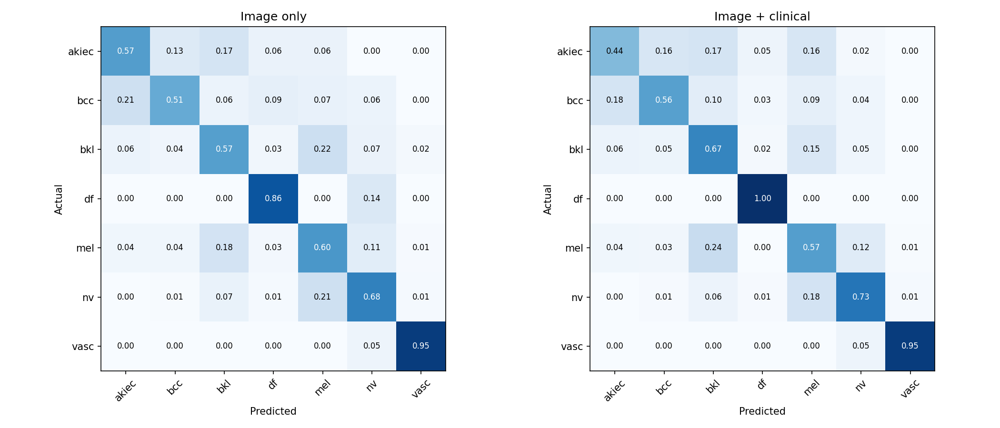

# Multimodal Skin Lesion Classification (HAM10000)

Classifies dermatoscopic skin lesion images into 7 diagnostic categories by combining **what the lesion looks like** (a CNN on the image) with **who the patient is** (age, sex, lesion location).

The notebook trains two models on the same split and compares them:

| Model | Inputs |
|---|---|
| A. Image only | lesion image (EfficientNetB0) |
| B. Multimodal | lesion image + age, sex, lesion location |

> **Research prototype, not a medical device.** It must not be used for diagnosis.

## Why multimodal?
A dermatologist does not judge a lesion from its picture alone. Age, sex and body location change how likely each diagnosis is. This project tests whether adding those clinical features improves on an image-only model.

## Dataset
[HAM10000](https://www.nature.com/articles/sdata2018161) (Tschandl et al., *Scientific Data*, 2018): about 10,000 dermatoscopic images with age, sex and lesion location, in 7 classes. About two-thirds of the images are benign nevi (`nv`), so the classes are heavily imbalanced.
Classes: `akiec`, `bcc`, `bkl`, `df`, `mel`, `nv`, `vasc`.

The images are **not** included in this repository. The dataset has a non-commercial licence, so check its terms before reusing or redistributing it. The notebook downloads it from Kaggle.

## Approach
1. **Split by lesion, not by image.** HAM10000 has several photos of the same lesion. A random image split would put the same lesion in train and test and inflate the score (data leakage). The notebook splits 70 / 15 / 15 on `lesion_id`.
2. **Clinical preprocessing, fitted on the training set only.** Missing age is filled with the training median, age is standardized, and sex and location are one-hot encoded.
3. **Image branch.** EfficientNetB0 pretrained on ImageNet, with light augmentation (flips, rotation, zoom, contrast).
4. **Clinical branch.** A small dense network (64 then 32 units).
5. **Fusion.** The image features and clinical features are concatenated, then a dense classifier outputs 7 probabilities.
6. **Class imbalance.** Class weights computed from the training set.
7. **Two-phase training.** First only the new layers are trained, then the top 40 layers of the backbone are fine-tuned at a learning rate of 1e-5 (BatchNorm layers stay frozen).
8. **Metrics.** Macro recall (every class counts equally), macro F1, melanoma recall, and accuracy, which is shown but not trusted on imbalanced data.

## How to run

### Google Colab (recommended, free GPU)
1. Open `notebooks/multimodal_skin_cancer_ham10000.ipynb` in Colab.
2. Runtime, then Change runtime type, then **T4 GPU**.
3. Run all cells. If asked for Kaggle credentials, enter your Kaggle username and API token (Kaggle: Settings, then API, then Create New Token).
4. Training takes roughly 20 to 30 minutes per model on a T4.

### Local
```bash
pip install -r requirements.txt
jupyter notebook notebooks/multimodal_skin_cancer_ham10000.ipynb
```
A GPU is strongly recommended.

## Results
Single run on the held-out test set (15 percent of lesions, split by `lesion_id`), seed 42. Raw numbers are in `results/results.csv`.

| Model | Accuracy | Macro recall | Macro F1 | Melanoma recall |
|---|---|---|---|---|
| Image only | 0.654 | 0.678 | 0.528 | 0.599 |
| Image + clinical | 0.691 | 0.704 | 0.571 | 0.567 |



**Observation:** Adding age, sex and lesion location improved accuracy (0.654 to 0.691), macro recall (0.678 to 0.704) and macro F1 (0.528 to 0.571). Per-class recall rose for `bkl`, `bcc`, `nv` and `df`, but it fell for `akiec` (0.57 to 0.44), and melanoma recall dipped slightly (0.599 to 0.567). The clinical features helped on average but did not improve the most safety-critical class. This is one run with one seed, and rare classes have few test images, so differences of a few points may be noise. Repeating the experiment over several seeds or grouped folds would show whether the gains hold.

## Limitations
- One public dataset and no external validation.
- Dermatoscopic images only, from specific clinics.
- The test set is small for rare classes, so per-class scores are noisy.
- A prototype for learning, not for clinical use.

## Possible extensions
- Grad-CAM heatmaps to show where the model looks.
- Probability calibration.
- Testing on another dataset such as ISIC.

## Repository layout
```
notebooks/   the full pipeline as one notebook
docs/        HOW_IT_WORKS.md, a plain-language guide with self-check questions
results/     results.csv and confusion_matrices.png from the run
```

## Licence
Code: MIT. Dataset: see its own licence.
